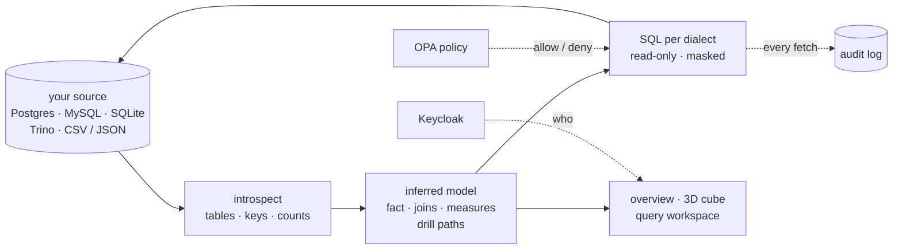

<p align="center">
  
</p>

<p align="center">
  <b>Point it at a database or drop in a file. It works out the model, then lets you walk around the answer.</b><br>
  <sub>A virtual OLAP explorer. Trace infers a semantic model from whatever you connect, then gives you an overview dashboard, an interactive 3D cube and a SQL workspace. Every query is pushed down to the source, read-only, policy-checked and audited.</sub>
</p>

<p align="center">
  <sub>
    <a href="#overview">OVERVIEW</a> &nbsp;·&nbsp;
    <a href="#quick-start">QUICK START</a> &nbsp;·&nbsp;
    <a href="#how-the-model-is-inferred">THE INFERRED MODEL</a> &nbsp;·&nbsp;
    <a href="#the-cube">THE CUBE</a> &nbsp;·&nbsp;
    <a href="#sources">SOURCES</a> &nbsp;·&nbsp;
    <a href="#run-it">RUN IT</a> &nbsp;·&nbsp;
    <a href="#guard-rails">GUARD RAILS</a>
  </sub>
</p>

<br>

<table>
  <tr>
    <td><sub>SETUP</sub><br><b>None. It infers the model.</b></td>
    <td><sub>DIALECTS</sub><br><b>Postgres · MySQL · SQLite · Trino</b></td>
    <td><sub>ACCESS</sub><br><b>Read-only sessions</b></td>
    <td><sub>POLICY</sub><br><b>OPA + Keycloak</b></td>
    <td><sub>NEEDS DOCKER</sub><br><b>No</b></td>
  </tr>
</table>

## Overview

Most BI tools ask you to describe your data before they will show it to you. Trace reads it instead.

Connect a database or drop in a CSV, and it works out the main table, the joins, the measures and the drill paths on its own. Then you get an overview dashboard, a 3D cube you can walk around and slice, and a SQL workspace.

> [!NOTE]
> Every query is pushed down to the source and runs in a read-only session, with a statement timeout and a row cap. Columns in `MASK_COLUMNS` never reach non-admins.

## Quick start

```bash
npm install
./run.sh            # http://localhost:5173, starts on the built-in retail demo
```

## Architecture




## How the model is inferred

Most BI tools ask you to describe your data before they will show it to you. Trace reads it.

1. **Introspect** tables, columns, keys and row counts. Where constraints are missing, `id` and `<table>_id` naming fills the gap.
2. **Pick the fact table** by scoring outbound keys, numeric columns, dates and size. You can override it.
3. **Join** dimensions by following foreign keys two hops out, a snowflake.
4. **Profile** candidate columns with one sampled query per table, keeping readable dimensions and dropping free text.
5. **Order drill paths** coarse to fine by cardinality (region → country → city). Dates become year → quarter → month.
6. **Derive measures:** counts, sums and averages of numeric fact columns, distinct counts of joined entities. Money-like names get currency formatting.
7. **Generate SQL per dialect,** joining only the tables a given query needs.

Switch sources and every view re-derives itself.

## The cube

A real X × Y × Z voxel cube, not a chart pretending to be one.

| To | Do |
|---|---|
| Inspect a cell | hover for crosshairs and the value, click to select |
| Drill in | double-click, or <kbd>Enter</kbd> |
| Slice | click an axis label |
| Dice a member out | <kbd>Shift</kbd>-click |
| Sweep a slice over time | playback |
| Pivot or roll up | <kbd>P</kbd>, or roll up any axis |
| Move around | camera presets <kbd>1</kbd>–<kbd>4</kbd>, arrows, <kbd>[</kbd> <kbd>]</kbd> |

A linked pivot table sits underneath. When a machine cannot hold 20 frames per second in 3D, the view falls back to a 2D heatmap.

**Overview** builds itself: KPIs for the trailing twelve months against the prior twelve, the main measure over time, breakdowns, a heatmap, top entities, and the inferred model. Every panel links to its SQL, and clicking a bar drills into the cube. **Query** has a schema tree, model-driven presets, a SQL editor, explain, streaming results, CSV export and snapshots. **Activity** keeps query history with replay, the audit trail, insights, alerts and notebooks.

## Sources

Exactly one source is active at a time. Switching closes the previous connection pool, and models are cached per source.

| Source | Notes |
|---|---|
| PostgreSQL | sessions are `default_transaction_read_only` |
| MySQL / MariaDB | `READ ONLY` sessions with an execution time limit |
| SQLite | opened read-only |
| Trino | coordinator, catalog, schema |
| CSV / JSON | drag and drop; loaded into an embedded Postgres with inferred types, joinable on `*_id` |
| Retail demo | built in: a star schema with about 80k orders |
| Fleet trips | built in: a synthetic ride-hailing database |

## Run it

```bash
npm install
./run.sh            # http://localhost:5173
```

Trace starts on the retail demo, running on an embedded Postgres, so it needs nothing else. If a Docker daemon is available, `./run.sh` also brings up Postgres, Trino, Keycloak and OPA; set `USE_DOCKER=false` to skip them.

```bash
npm test                                   # connector tests, no external services
npm -w apps/web run typecheck
bash infra/scripts/sanity_check.sh
```

The connector tests run each dialect end to end without a database server: SQLite through `node:sqlite`, and PostgreSQL through the real `pg` driver talking to PGlite over the wire protocol.

## Guard rails

| | |
|---|---|
| **Read-only** | every external session is opened read-only, with a statement timeout and a row cap |
| **PII masking** | columns in `MASK_COLUMNS` are hidden from the model and masked in raw results for non-admins |
| **Policy** | OPA evaluates queries, schema access, exports and source activation |
| **Auth** | Keycloak JWT with PKCE in the web app, or an API key |
| **Audit** | every data fetch is logged |
| **Credentials** | stored server-side, mode 600, never in git |

| Variable | Default | |
|---|---|---|
| `ENGINE` | `auto` | Trino if reachable, else the last source |
| `AUTH_REQUIRED` | `false` | restricts source management to admins |
| `MASK_COLUMNS` | `customers.name,drivers.name,email,phone` | |
| `MAX_RESULT_ROWS` | `50000` | |
| `STATEMENT_TIMEOUT_MS` | `30000` | |
| `OPA_ENABLED` | `false` | |

<details>
<summary><b>Layout and docs</b></summary>
<br>

```
apps/api/               Fastify: connectors, source registry, the inferred model, query and stream routes
apps/web/               React + Vite: overview, cube (three.js), query workspace, sources
packages/shared-types   DTOs shared by both
services/               OPA policies, Keycloak realm, Trino config
infra/                  compose, seed and launcher scripts
```

[Product walkthrough](docs/PRODUCT_WALKTHROUGH.md) · [System design](docs/SYSTEM_DESIGN.md) · [API spec](docs/API_SPEC.md) · [Auth setup](docs/AUTH_SETUP.md) · [MVP status](docs/MVP_STATUS.md)

</details>
